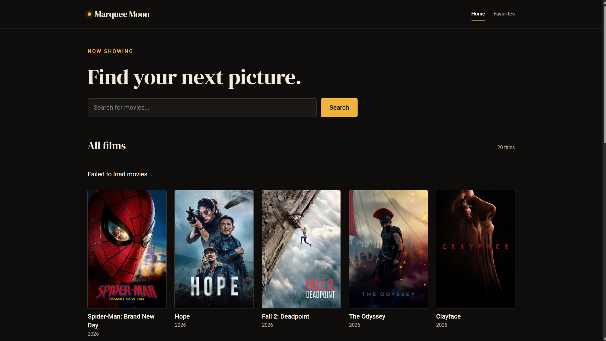

# Marquee Moon v0.3.0

Marquee Moon is an aggregator page that presents films in a clean, poster-first layout. At this stage it is a React single-page application styled with Tailwind CSS and allows browsing and searching of movies as well as creating your own favorites list. I am currently fetching data from the TMDB API, but my future goal is to draw from many different sources and perhaps even creating a multi-page structure that will allow users to browse other multimedia types like television series, music albums, radio shows, theatre productions, etc.



## New Features (v0.3.0)

- Search now covers the full TMDB catalogue: type a title and press Search to replace the grid with the matching films.
- Movie cards show each film's release year.

## Tech Stack

- 
- 
- 
- 
- 

## Learning Goals

- improve my experience with data fetching and API requests, and deal with the various problems that arise in the process.
- design better solutions for potential users.
- be able to begin from a basic, generic functionality and gradually provide a more expertized and distinctive application purpose.
- get deeper into React and explore its potential at greater depth.
- get an even more concrete understanding of browser behavior and debugging approaches.
- increase my experience and familiarity with DevOps practices, CI/CD operations, and professional development workflows.

## AI-Assisted Development

Claude Code was used as an AI coding assistant during the development of this project. My emphasis as a developer and my learning goals (and, therefore, the skills this project is meant to demonstrate) are mostly focused in the following areas:

- overall full-stack design and integration
- backend/database workflows, including data modelling and database schema design
- data fetching/scraping/extraction/manipulation techniques
- security concerns (authentication, validation, login mechanisms)
- implementation of appropriate business practices

It is impossible in our times to fully separate code written by AI and human hand, but my contribution is more acutely felt in the areas above. For this project then, I take a greater share of responsibility for the code handling API requests, data manipulation/management, general backend logic and DevOps practices. And of course setting up the project and creating its initial template, defining its purpose and requirements, directing design iterations, reviewing generated code and integrating components into the application.

Now, in other areas... well, besides using Claude Code as a general assistant to speed up processes, I particularly used its services for UI design exploration, visual styling, and implementation of frontend components. My usual strategy is to describe the brand/project aimed aesthetic and target audience (`docs/ai/design-directions/brand-character.md`), create or adjust the necessary skills (as found in the relevant `.claude` folder), set up guidelines and then ask it to present me with two or three alternative stylings that I can review and choose from. Then, I may tinker a bit with the code myself to refine them further.

AI-generated code was reviewed and adapted as needed. But the overall responsibility and any possible flaws of the project are mine.

## How to Run

Visit the live site: [https://marquee-moon.vercel.app/]

Locally: you need to have a current Node.js LTS release and npm installed.

```bash
# Install dependencies
npm install

# Start the development server (http://localhost:5173 by default)
npm run dev

# Check the code with ESLint
npm run lint

# Build for production into the dist folder
npm run build

# Serve the production build locally
npm run preview
```

## Future Goals

Implement the Favorites pages and its mechanism.

## To Fix

- In development, "Failed to load movies..." appears above the grid even when the films load. React's Strict Mode cancels the first request on purpose, and the error handler treats that cancellation as a failure.
- `npm run lint` fails because `searchMovies` is imported in `Home.jsx` but not used yet.

## To Improve

- **Search engine UX**: the current setup is misleading. The user doesn't understand that they need to press the Search button to perform a search on all available movies and not just the already existing most popular ones. **Suggestion**: add filters for searching (e.g, Popular Movies This Week) and so the search engine takes the filters into account to limit the sample in which it performs the search. This way, I can give the users the hints they need to know what to expect from the search engine's behavior.

## Insights

Check the docs folder for material concerning this project: bugs that remain to be fixed, areas that still need improvement, the problems I faced during the project's construction, skills I learned or improved, areas I hope to improve in the future, and general realizations or thoughts I had during this project.

## License


This project is distributed under the MIT License. See the `LICENSE` file for the full text and details.

## How to Reach Me

* You can reach me via the email address on my profile page or through my LinkedIn profile: [Kostas Topouzis | LinkedIn](https://www.linkedin.com/in/kostas-topouzis-03992b410/)
* If you are interested, you can also check my music on my official artist channel. I operate under the name Vayos Avramides: [Vayos Avramides | YouTube](https://www.youtube.com/@vayosavramides). Also, feel free to follow my Facebook channel: [Vayos Avramides | Facebook](https://www.facebook.com/profile.php?id=61594800706567)
